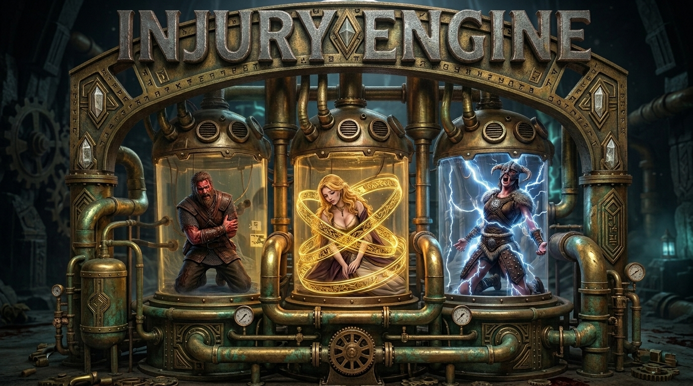

# Injury Engine

Per-body-part injuries for [SkyrimNet](https://github.com/MinLL/SkyrimNet-GamePlugin). Damage from any source (swords, arrows, spells, creatures, falls and torture) wounds a body part, and the wound gets worse from light to medium to severe. While the wounds heal, every character who looks at the victim knows what they look like, and the victim knows how they feel. Hits, healing and killing blows are narrated to the LLM, and an overlay shows each tortured actor's damage.

Torture is built in: whipping (with a padded whip), pinching, slapping, pulling, punching, and fire, frost and shock torture spells. Torture hurts but cannot kill. NPCs can torture someone with the Torture_Target LLM action.

## Features

- **Injuries from all damage**: each hit is classified by what caused it: slashing, piercing, bludgeoning, burning, freezing, shocking, mauling, falling, drowning, generic, or one of the torture types. The wound lands on a body part: face, back, left or right arm, left or right leg, plus optional sexual parts; drowning hurts the lungs alone. Each part moves through light, medium and severe.
- **Healing**: wounds heal over game time, with healing spells, staffs and potions, and slowly with natural regeneration. When a healing source starts working on someone, a heal session begins: it is narrated, and the wounds are described by how far they have healed.
- **Narration**: real-damage hits, torture, healing and killing blows are narrated to the LLM, or recorded as short-lived events when narration isn't allowed. A narration isn't allowed when it is turned off, when the victim is out of sight, or when someone is already speaking. Continuous torture is combined into one narration every few seconds, covering everyone torturing at the same time. A change of method is narrated at once.
- **Wound prompts**: a character-bio section says what each wounded part looks like. A final-instructions section tells the speaker how their wounds feel, or how the healing feels while a spell, staff or potion is working.
- **Torture damage**: torture types are whipping, pinching, slapping, pulling and punching (fists outside combat), plus fire, frost and shock torture. Fire, frost and shock come from the spells Torture Flames, Torture Frostbite and Torture Sparks; the normal spells stay real damage. Torture holds health down but never below 10%, so it can't kill. Each type is tracked per body part, but a part counts only its worst type, and healing a part heals every type on it at once.
- **Torture_Target LLM action**: an NPC walks to the target and whips, pinches, slaps, pulls or punches them 1–N times. Whipping needs the padded whip.
- **Stop_Fighting / Stop_Fighting_by_Yielding / Start_Fighting LLM actions**: an NPC in a fight can offer to stop, or yield (surrender: it puts its weapon away at once, and the other side may accept the surrender or keep attacking); SkyrimNet's decision model decides whether the other side accepts (needs a decision provider set up in SkyrimNet, otherwise the offer is refused). Accepted: both stand down and stay calm for a day. Refused: the NPC stands down, the other may fight on. When the offer or surrender is made to you, a Yes / No box asks whether you accept. Any NPC can also start a fight with someone, or switch targets mid-fight.
- **Padded whip** (`Injury_Engine_PaddedWhip`): every real hit with it is a lash. To get one:
  - craft it at the forge with DOM's recipe (leather strips plus one other vanilla item);
  - use "Add gear to player";
  - or type `help "Padded whip"` → `player.additem` in the console.

  A lash leaves the same welt decal as DOM.
- **Torture overlay**: a "Torture Damage" bar per tortured actor. It shows how much the last kind of torture (whip, pinch, fire, ...) has wounded the parts it can reach, each kind in its own color. It is light blue while the actor is being healed and red where real damage has replaced torture. It fades out by itself.
- **Extensible**: other mods can add their own injury types as `injuries/<id>.json`; SkyrimNet_Leashed adds leash dragging. Other mods can also wound or heal a chosen body part through the External API ([docs/developers/papyrus.md](docs/developers/papyrus.md)).

The whip, its welt decal, and its sounds come from **PAH Diary Of Mine**. This mod does not need DOM.

## Settings (SkyrimNet dashboard → Injury_Engine)

| Key | Dashboard name | Default | Meaning |
|-----|----------------|---------|---------|
| `injury_engine.narration.injury_mode` | Injury Narration | Direct Narration | Real-damage hits: Direct Narration (when allowed, else an event), Event, or Silent |
| `injury_engine.narration.healing_mode` | Healing Narration | Direct Narration | Healing by spells, staffs and potions, same choices |
| `injury_engine.narration.death_mode` | Death Narration | Direct Narration | Killing blows from real damage, same choices |
| `injury_engine.narration.torture_mode` | Torture Narration | Direct Narration | Torture, same choices |
| `injury_engine.ranges.minor_min` | Minimum damage for minor | 25 | Percent of a body part's maximum where a real wound (not torture) becomes minor. Below it the wound counts but is not narrated or described. |
| `injury_engine.ranges.major_min` | Minimum damage for major | 75 | ... becomes major |
| `injury_engine.ranges.severe_min` | Minimum damage for severe | 90 | ... becomes severe. No body part can be hurt worse than the body has lost health: while health is between 75% and 26% no part gets past minor. |
| `injury_engine.action.require_whip` | NPC must already carry a whip | on | Only NPCs carrying the padded whip can whip with Torture_Target. Off: one is handed over for the lashing. |
| `injury_engine.action.give_to_player` | Add gear to player | on | Give the player the padded whip and the three torture spells |
| `injury_engine.action.max_strikes` | Maximum lashes per action | 10 | Most strikes per Torture_Target action (the action offers up to ten) |
| `injury_engine.healing.hours_per_point` | Game hours per heal point | 1 | Game hours per torture point healed |
| `injury_engine.healing.regen_rate` | Natural regen vs. torture wounds (%) | 10 | How fast natural regeneration heals torture wounds |
| `injury_engine.healing.give_healing_hands` | Add Healing Hands to player | on | Teach the player Healing Hands |
| `injury_engine.narration.enabled` | Narrate lashes | on | Direct Narrations for torture and healing (off = events only) |
| `injury_engine.narration.torture_narration_window_size` | Torture narration window | 30 s | Passive healing is not reported for this long after a torture hit |
| `injury_engine.narration.torture_maximum_break` | Torture maximum break | 3 s | A pause this long ends a torture session |
| `injury_engine.narration.torture_direct_narration_gap` | Torture direct narration gap | 6 s | How often continuous torture is narrated |
| `injury_engine.narration.reply_timeout` | Wait for reply | 15 s | After a narration, the next one waits for SkyrimNet's spoken reply, or this long without any dialogue |
| `injury_engine.narration.health_narration_cooloff` | Health narration cooloff | 6 s | At most one real-damage narration this often |
| `injury_engine.narration.cooldown` | Narration cooldown | 8 s | Per-actor healing narration cooldown |
| `injury_engine.narration.max_distance` | Narration max distance | 15 m | Farther hits and healing become events |
| `injury_engine.narration.event_ttl` | Lash event lifetime | 30 s | How long a short-lived hit event stays in the scene context |
| `injury_engine.body.include_sexual_parts` | Include sexual body parts | off | Also wound the nipples, pussy (women), penis (men), lips and ass hole. These parts are hit less often and hold less damage, but still go through light, medium and severe. |
| `injury_engine.body.torture_bleedout` | Tortured victims collapse into bleedout until healed | on | When torture brings someone down to 15% health they collapse into the bleedout pose and stay down until their health is above 15% again. The next torture narration says that they collapse. |
| `injury_engine.body.uncaused_min_percent` | Minimum uncaused damage (%) | 5 | Health lost with no attacker, hit or real fall (other mods' scripts, bathing or animation mods, stairs) becomes a wound only if it is still missing about 1.5 seconds later and is at least this percentage of max health. 0: any lasting loss counts. |
| `injury_engine.body.punch_combat_health` | Punching during combat is health not torture | off | Off: bare-fist punches by people are torture in and out of combat and cannot kill. On: punches during combat are real bludgeoning damage. |
| `injury_engine.overlay.enabled` | Show torture overlay | on | Show the torture overlay |
| `injury_engine.debug.verbose_logging` | Verbose logging | off | Extra debug lines in `Injury_Engine.log` and `Papyrus.0.log` (for troubleshooting) |

## Requirements

SKSE, Address Library for SKSE Plugins, SkyrimNet (Beta 25+), PapyrusUtil SE, and **PrismaUI** (required: the overlay is built on it).

## Install

Install `Injury_Engine <version>.7z` with your mod manager (FOMOD). Enable `Injury_Engine.esp`. Two options, both checked by default:

- **Add fight/stop/yield actions**: installs the `Start_Fighting`, `Stop_Fighting` and `Stop_Fighting_by_Yielding` actions. Unchecked, NPCs can't start, stop or yield fights through the LLM (`Torture_Target` is always installed).
- **Show torture overlay**: unchecked, the dashboard setting "Show torture overlay" defaults to off (it can still be turned on in the dashboard). A value already saved in the SkyrimNet dashboard is kept.

## How injuries are tracked

The game engine owns decals: they can vanish on a cell change or reload, and scripts can't query them. So `Injury_Engine.dll` (InjuryEngine, saved in the SKSE co-save) tracks every actor's body parts itself, per injury source. An actor is forgotten once every part is healed. Decorator `injury_engine_injuries(uuid)` returns the injuries of every source, with their descriptions already written for that actor.

### Real damage

Ordinary damage is classified by what hit the actor:

| Source | Caused by |
|---|---|
| slashing | swords, axes |
| piercing | daggers, arrows |
| bludgeoning | maces, hammers, staves, fists |
| burning, freezing, shocking | fire, frost and shock spells |
| mauling | creatures |
| falling | landing from a height |
| drowning | running out of air under water (lungs only; the stage follows how much of the actor's health the water took) |
| generic | anything else |

Each health point lost becomes damage on a body part, so all parts at maximum means no health left. Damage goes through the same light, medium and severe stages as torture. Health regained heals random injuries one point at a time, and a type, a body part and the whole body are each reported as they finish healing. A killing blow is narrated with the wound that caused it.

### Torture

| Torture points | Torture stage | Heal level (while healing) |
|---|---|---|
| 1–3 | light | high |
| 4–10 | medium | mid |
| 11+ | severe | low |

Each torture hit adds points to a body part, and healing takes them away again:
- every `hours_per_point` game hours, a part loses 1 point;
- health restored by spells, potions or regeneration heals random parts one point at a time.

While a heal session is open, the overlay bar turns light blue and the narration describes each wounded part at its heal level. For example, a part at 15 points is "low", and once it has healed down to 9 it is "mid". A new hit ends the session.

### Real damage replaces torture

Real damage first replaces torture damage. While an actor still has torture wounds, a real hit does not lower health: the part's worst torture type drops, and the other types are clamped to it. The overlay shows the replaced part as a red bar. Once all torture is replaced, further damage is normal and can kill. Torture wounds keep their own rules: they heal over time and never take health below 10%.

### Editing and adding injury types

Everything about injuries lives in `SKSE/Plugins/Injury_Engine/injuries/*.json`, one file per source:
- what the LLM reads about injuries;
- the Torture_Target text;
- the overlay title and colors;
- the setting defaults.

Other mods can ship their own `<id>.json` there, and it loads like the built-in ones. `injuries/guide.md` explains the format and is a ready-made instruction sheet you can give to a chat assistant to improve or extend the files.

## Building

- SKSE plugin: run `make dll`. It needs CMake and vcpkg, with `VCPKG_ROOT` set. CommonLibSSE is MinLL/CommonLibVR 4.39.5 (MIT), taken from the overlay port `SKSE_Source/vcpkg-ports/commonlibsse-ng-fork`; a clean configure builds it in about 6 min. The .dll is copied to `SKSE/Plugins/`.
- Scripts: VS Code task "compile: papyrus" (`.vscode/tasks.json`, papyrus-compiler `papyrus.exe`).
- ESP: `make esp` builds `Injury_Engine.esp` from `Spriggit/Injury_Engine/`. After editing in xEdit, run `make serialize`.
- Release: `make release` → `versions/Injury_Engine <version>.7z` (FOMOD + core). Procedure: [release-guide.md](release-guide.md).
- `tools/patch_nif_paths.py` repoints copied DOM meshes to `textures\weapons\SNW\` (already applied).

## Credits

Whip mesh, textures, decal and sounds: PAH Diary Of Mine.

## License

MIT, see [LICENSE](LICENSE). The SKSE plugin statically links [MinLL/CommonLibVR](https://github.com/MinLL/CommonLibVR) 4.39.5 (MIT) and [OpenVR](https://github.com/ValveSoftware/openvr) (BSD-3-Clause).
