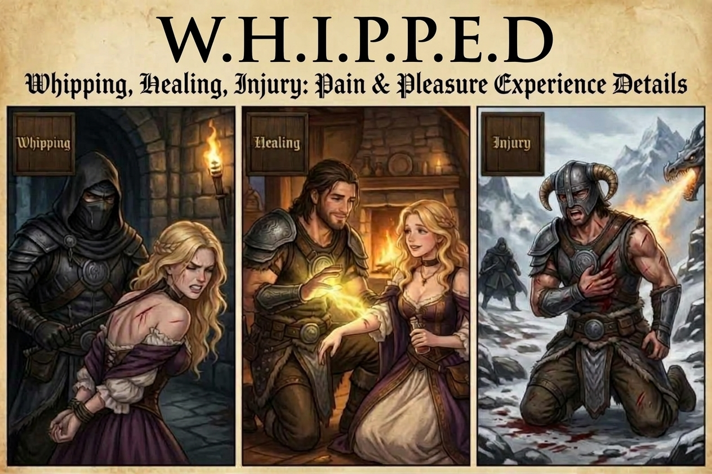

# SkyrimNet W.H.I.P.P.E.D.

Whipped Healing Injury: Pleasure & Pain Experience Details

A standalone padded whip for [SkyrimNet](https://github.com/MinLL/SkyrimNet-GamePlugin). Each lash wounds a random body part (face, back, left/right arm, left/right leg). The hit is narrated to the LLM, and while the wounds heal, every character who looks at the victim knows what they look like and the victim knows how they feel.

The whip, its welt decal, and its sounds come from **PAH Diary Of Mine**. This mod does not need DOM.

## Features

- **Padded whip** (`SkyrimNet_Whipped_PaddedWhip`): craftable at the forge with DOM's recipe (leather strips plus one other vanilla item), or `help "Padded whip"` → `player.additem`.
- **Welt decal on hit**: the same engine impact chain as DOM (weapon → impact data set → flesh impact → `SNW_WhipMarkDecal.dds`).
- **Direct Narration on hit**: "Nina's face is hit by Ulfric's whip, a sudden, sharp slap of raw shock…", worded by how damaged that part already was (undamaged, light, medium, severe). A per-victim cooldown and a distance limit apply; lashes inside them are recorded as events.
- **Wound prompts**: a character-bio section with what each wounded part looks like, and a final-instructions section with how it feels to the speaker. Both follow each part from light, medium and severe damage through recovering, mostly healed and healed (scarred).
- **Whip_Target LLM action**: an NPC walks to the target and lashes them 1–N times, followed by one summary narration.

## Settings (SkyrimNet dashboard → SkyrimNet_Whipped)

| Key | Default | Meaning |
|-----|---------|---------|
| `whip.action.require_whip` | on | The NPC must already carry the padded whip to use Whip_Target. Off: one is handed over for the lashing. |
| `whip.action.max_strikes` | 10 | Most lashes per action (applies after a reload) |
| `whip.healing.hours_per_point` | 1 | Game hours per point of damage drained, then per healing point gained |
| `whip.narration.enabled` | on | Narrate lashes (off = events only) |
| `whip.narration.cooldown` | 8 s | Per-victim narration cooldown |
| `whip.narration.max_distance` | 15 m | Farther lashes become events |

## Requirements

SKSE, Address Library for SKSE Plugins, SkyrimNet (Beta 25+), PapyrusUtil SE, and **PrismaUI** (required: the whipping overlay is built on it).

## Install

Install `SkyrimNet_Whipped <version>.7z` with your mod manager (it is a FOMOD with no options; everything is required). Enable `SkyrimNet_Whipped.esp`.

## How wounds are tracked

The engine owns decals: they can vanish on a cell change or reload, and scripts can't query them. So `SkyrimNet_Whipped.dll` (InjuryEngine, saved in the SKSE co-save) tracks each actor's six body parts, per injury source (whip wounds plus classified real damage, see below):

| Damage | Stage | | Healing (damage 0) | Stage |
|---|---|---|---|---|
| 1–3 | light | | 0–3 | recovering |
| 4–10 | medium | | 4–10 | mostly healed |
| 11+ | severe | | 11 | healed (scar) |

Each lash adds 1 damage to a random part; a part that is already healing reopens at damage 4. Every `hours_per_point` game hours a part loses 1 damage, then gains 1 healing; health restored by spells, potions or regeneration heals random parts one point at a time. Each part that heals to its next stage is narrated like a hit (first one always, later ones batched behind the cooldown or kept as short-lived events); only "fully healed" is always a Direct Narration. An actor is forgotten once every hit part is healed. Decorator `skyrimnet_whipped_injuries(uuid)` returns the injuries of every source with their descriptions already written for that actor.

### Other injuries

Ordinary damage is tracked too, classified by what hit the actor: slashing (swords, axes), piercing (daggers, arrows), bludgeoning (maces, hammers, staves, fists), burning, freezing and shocking (fire, frost and shock spells), mauling (creatures) and generic (anything else). Each health point lost becomes damage on a random body part (all parts at maximum = no health left) with the same light / medium / severe stages, and health regained heals random injuries one point at a time; a type, a body part and the whole body are each reported as they finish healing. Real damage first replaces whip damage: while an actor still carries whip wounds the hit does not lower health, and the overlay shows the replaced part as a darker red bar; once all whip wounds are replaced, further damage is normal and can kill. Whip wounds themselves keep their special rules (damage, then healing over time, never below 10% health).

### Editing the injury text and numbers

Everything the LLM reads about injuries, the Whip_Target text, the overlay title and colors and the setting defaults are in `SKSE/Plugins/SkyrimNet_Whipped/injuries/*.json` (one file per source). `injuries/guide.md` is a ready-made instruction sheet you can give to a chat assistant to improve or extend them.

## Building

- SKSE plugin: `make dll` (CMake + vcpkg, `VCPKG_ROOT` set; CommonLibSSE is MinLL/CommonLibVR 4.39.5 (MIT) from the overlay port `SKSE_Source/vcpkg-ports/commonlibsse-ng-fork`; a clean configure builds it, ~6 min). The .dll is copied to `SKSE/Plugins/`.
- Scripts: `pyro skyrimse.ppj` (VS Code task "compile: pyro").
- ESP: `make esp` builds `SkyrimNet_Whipped.esp` from `Spriggit/SkyrimNet_Whipped/`. After editing in xEdit, run `make serialize`.
- Release: `make release` → `versions/SkyrimNet_Whipped <version>.7z` (FOMOD + core). Procedure: [release-guide.md](release-guide.md).
- `tools/patch_nif_paths.py` repoints copied DOM meshes to `textures\weapons\SNW\` (already applied).

## Credits

Whip mesh, textures, decal and sounds: PAH Diary Of Mine.

## License

MIT, see [LICENSE](LICENSE). The SKSE plugin statically links [MinLL/CommonLibVR](https://github.com/MinLL/CommonLibVR) 4.39.5 (MIT) and [OpenVR](https://github.com/ValveSoftware/openvr) (BSD-3-Clause).
